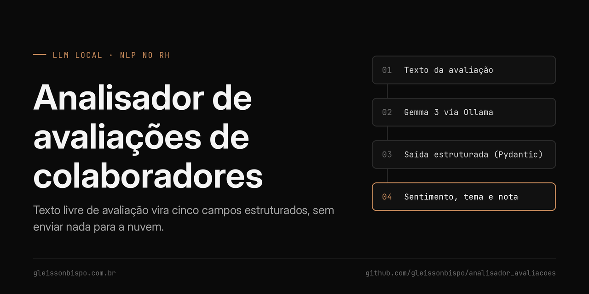
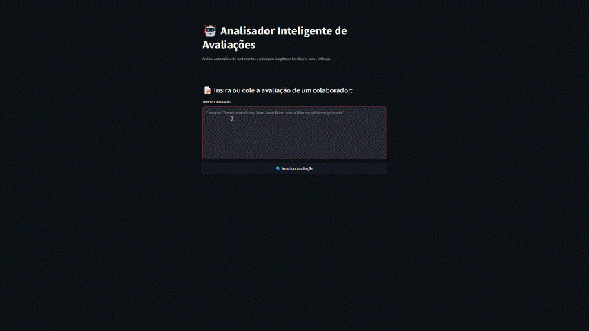
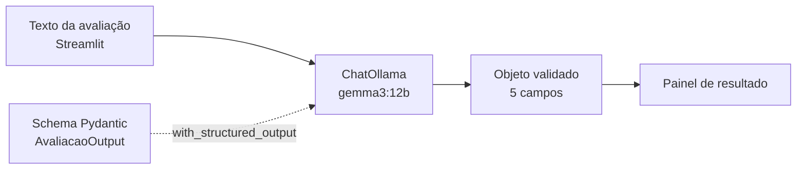

# Analisador de avaliações de colaboradores com LLM local

Aplicação em Streamlit que lê o texto livre de uma avaliação (pesquisa de clima, entrevista de desligamento, comentário em site de empregador) e devolve cinco campos estruturados: sentimento, ponto principal, palavra-chave, resumo e nota de satisfação. O modelo roda na própria máquina, via Ollama.



## Problema

Pesquisa de clima e entrevista de desligamento geram muito texto aberto. Ler tudo à mão não escala, e a análise de sentimento clássica entrega só um rótulo de positivo ou negativo, sem dizer do que a pessoa está falando. Além disso, comentário de colaborador é dado sensível: mandar esse texto para uma API externa costuma esbarrar em segurança da informação e LGPD.

## Solução

O texto vai para um LLM local com saída estruturada. Em vez de pedir uma resposta livre e tentar interpretar depois, o app define um schema Pydantic e usa `with_structured_output` do LangChain, que obriga o modelo a responder nesse formato:

| Campo | Tipo | O que traz |
|---|---|---|
| `sentimento` | texto | Muito Positivo, Positivo, Neutro, Negativo ou Muito Negativo |
| `ponto_principal` | texto | O ponto mais relevante citado na avaliação |
| `palavra_chave` | texto | Uma palavra-chave extraída do texto |
| `resumo` | texto | A avaliação em uma frase |
| `nota_satisfacao` | inteiro | Satisfação estimada, de 0 a 10 |

Com o resultado em campos, dá para somar, filtrar e cruzar com outras bases, o que um parágrafo de resposta livre não permite.

## Arquitetura



Todo o código está em `analise_avaliacoes.py` (cerca de 90 linhas): o schema, a inicialização do modelo e a interface.

## Como rodar

Pré-requisitos: Python 3.10 ou superior e o [Ollama](https://ollama.com) instalado.

```bash
# 1. Baixe o modelo (cerca de 8 GB)
ollama pull gemma3:12b

# 2. Clone e instale
git clone https://github.com/gleissonbispo/analisador_avaliacoes.git
cd analisador_avaliacoes
python -m venv .venv && source .venv/bin/activate   # no Windows: .venv\Scripts\activate
pip install -r requirements.txt

# 3. Suba a aplicação
streamlit run analise_avaliacoes.py
```

O app abre em `http://localhost:8501`. Para usar outro modelo, troque o nome em `ChatOllama(model="gemma3:12b")`. O modelo precisa suportar saída estruturada no Ollama.

## Exemplo de uso

Entrada:

```text
A empresa oferece bons benefícios e o time é colaborativo, mas a liderança é
desorganizada. As metas mudam toda semana, não existe plano de carreira e as
promoções saem por proximidade com o gestor. Estou procurando outra oportunidade.
```

Saída esperada (o conteúdo varia a cada execução, a estrutura não):

```json
{
  "sentimento": "Negativo",
  "ponto_principal": "Liderança desorganizada e ausência de plano de carreira",
  "palavra_chave": "liderança",
  "resumo": "Bons benefícios e time colaborativo não compensam a falta de direção e de critério nas promoções.",
  "nota_satisfacao": 4
}
```

## Limitações

- Analisa uma avaliação por vez. Não há processamento em lote nem visão agregada.
- O rótulo de sentimento e a nota são estimativas do modelo, sem calibração contra uma base anotada. Servem para triagem, não para decisão individual sobre uma pessoa.
- O schema descreve os cinco rótulos de sentimento, mas não os impõe como enumeração: o modelo pode devolver uma variação fora da lista.
- Nenhum resultado é salvo.
- Não há testes automatizados.

## Próximos passos

- Upload de CSV para analisar uma pesquisa inteira e exportar o resultado.
- Agregações por área, tema e período.
- Trocar o campo de sentimento por `Literal` e a nota por um inteiro com faixa validada.
- Avaliar o modelo contra uma amostra anotada por pessoas.

## Privacidade

O texto não sai da máquina: a inferência acontece no Ollama local e o app não grava nada em disco.

## Autor

**Gleisson Bispo**, Gerente de People Analytics. Escrevo sobre dados de pessoas, Data Science e IA aplicada a RH.

- Site: [gleissonbispo.com.br](https://gleissonbispo.com.br) (projetos, artigos, radar de notícias e vagas de People Analytics)
- Este projeto no site: [gleissonbispo.com.br/projetos/analisador-de-avaliacoes-llm](https://gleissonbispo.com.br/projetos/analisador-de-avaliacoes-llm)
- LinkedIn: [linkedin.com/in/gleissonbispo](https://www.linkedin.com/in/gleissonbispo)
- Newsletter: [People Analytics LAB](https://www.linkedin.com/newsletters/people-analytics-lab-7423156507271368704), no LinkedIn
- GitHub: [@gleissonbispo](https://github.com/gleissonbispo)

